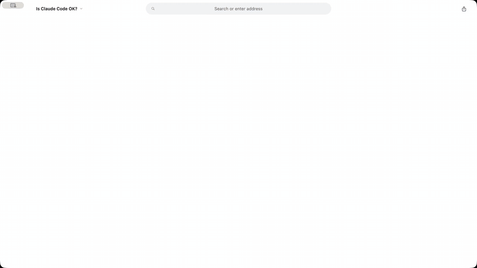

# Banquish skill for AI agents

Your agent answers with the live web: it opens the real pages in [Banquish](https://banquish.space/?ref=skills) on your Mac, signed in as you, and puts the part of each page that answers you (a price, a score, a ranking, a chart) on one live wall. The parts keep updating after the agent is done.



```
npx skills add banquish-app/skills
```

Works with Claude Code, Codex, Cursor, OpenClaw and the other agents the [skills CLI](https://skills.sh) supports. The skill tells your agent when to answer in Banquish, and how to install and connect Banquish if it isn't there yet.

## Try it

Ask your agent:

- "Show me the top 5 stories on Hacker News in Banquish, live."
- "Make a Banquish board of today's weather in Seoul, Tokyo and New York, side by side."
- "Keep an eye on the price of these headphones at three stores, side by side."
- "What do my Banquish Workspaces show right now?"

## What you need

- A Mac with Apple silicon (macOS 13 or later).
- Banquish, free: [download it](https://banquish.space/?ref=skills) or run `brew install --cask banquish-app/tap/banquish`. Open it once.
- Banquish connected to your agent. Banquish's **Connect your agent** window does Claude Code, Codex and Claude Desktop in one click; the skill walks your agent through the rest. Cursor users can also [add Banquish to Cursor](https://cursor.com/en/install-mcp?name=banquish&config=eyJjb21tYW5kIjoibnB4IiwiYXJncyI6WyIteSIsImJhbnF1aXNoLW1jcEAwLjEuMSJdfQ==).

Claude on the web and ChatGPT connect through Banquish's Relay instead: in Banquish, choose File › Connect Claude… or File › Connect ChatGPT….

## What runs on your machine

This repository holds one skill: a Markdown file of instructions, no code. The agent talks to Banquish through `~/.banquish/bin/banquish`, which the app installs. Pages load in Banquish on your Mac, the way your browser loads them. Agents can't type into sites, submit forms or delete Workspaces, and sites you mark private are hidden from them. [Privacy](https://banquish.space/privacy?ref=skills) · [Docs](https://banquish.space/docs?ref=skills) · [For agents](https://banquish.space/agent.md?ref=skills)

## Support

Open an issue here, or write to [hello@banquish.space](mailto:hello@banquish.space).

## License

The skill is MIT licensed; see [LICENSE](LICENSE). The Banquish app is distributed separately.
